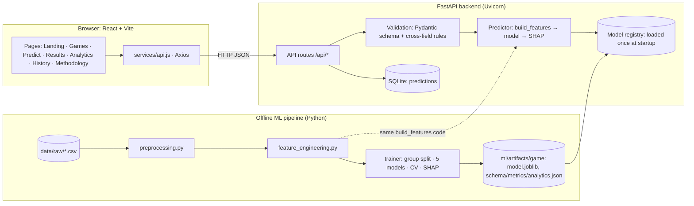
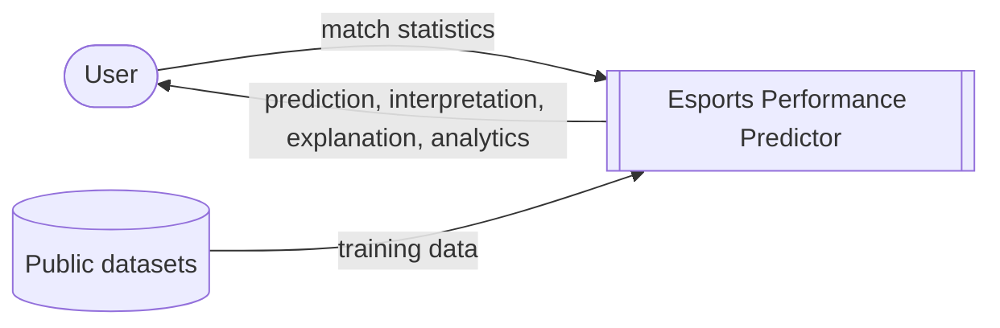
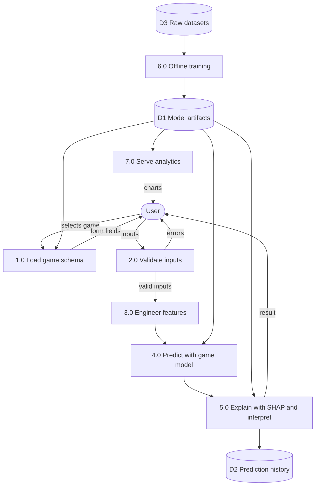
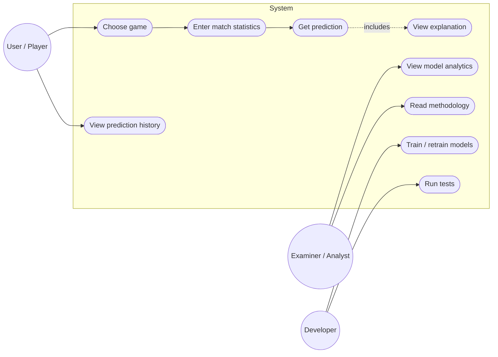
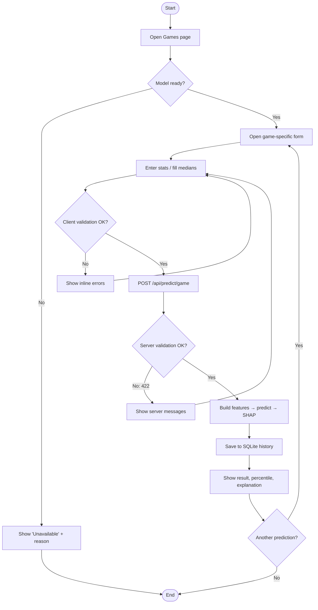
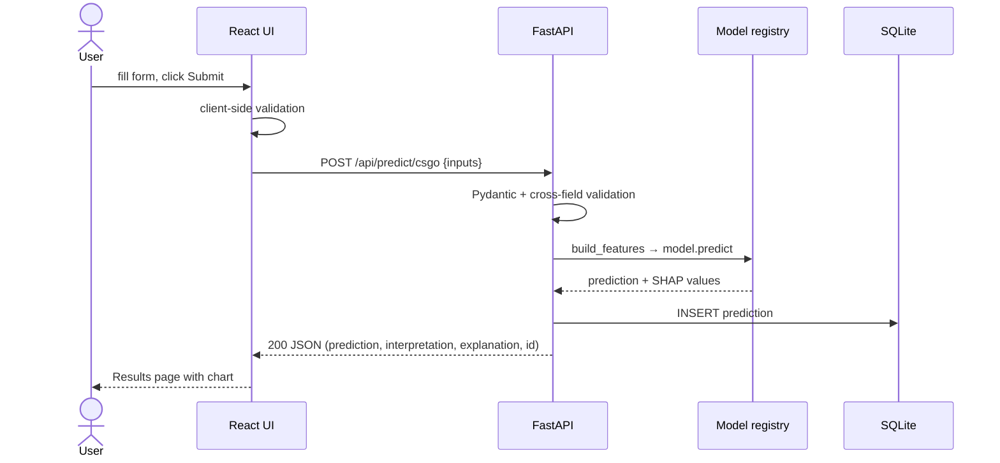
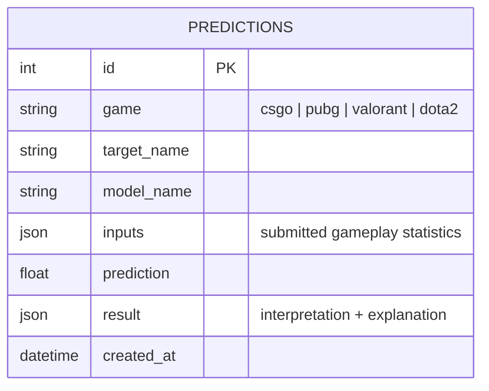

# System Architecture & Diagrams

The diagrams below are written in Mermaid. They render on GitHub, in VS Code (with a Mermaid preview extension)
and at https://mermaid.live, where they can also be exported as PNG/SVG for the report.

## 1. System architecture

## 2. Data flow diagram

**Level 0 (context)**

**Level 1**

## 3. Use-case diagram

## 4. Activity diagram: making a prediction

## 5. Sequence diagram

## 6. ER diagram (database)

Authentication is not implemented and no personal data is stored, so the database has one table.

A future `USERS` table would relate one-to-many to `PREDICTIONS` (`user_id` FK). Switching to MySQL only
requires changing `DATABASE_URL`.

## 7. Backend module layout

| Module | Responsibility |
|---|---|
| `app/main.py` | App factory, CORS, lifespan (init DB + load models), global error handlers |
| `app/core/config.py` | Settings from environment / `.env`; makes `ml/` importable |
| `app/services/registry.py` | Loads artifacts for each game; marks a game unavailable with a reason if files are missing |
| `app/services/predictor.py` | Dynamic Pydantic validation, feature building, prediction, SHAP, interpretation, warnings |
| `app/models/database.py` | SQLAlchemy model and repository functions |
| `app/schemas/api.py` | Request/response models |
| `app/api/routes.py` | HTTP endpoints |
