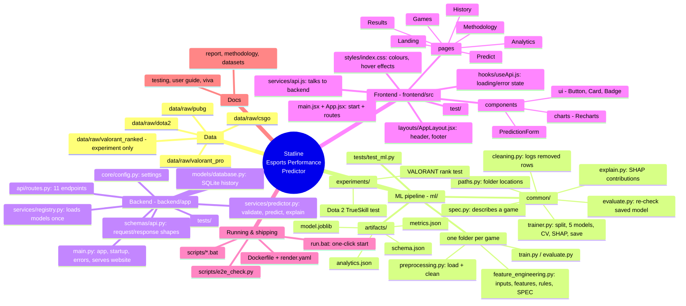
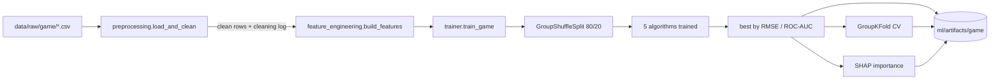
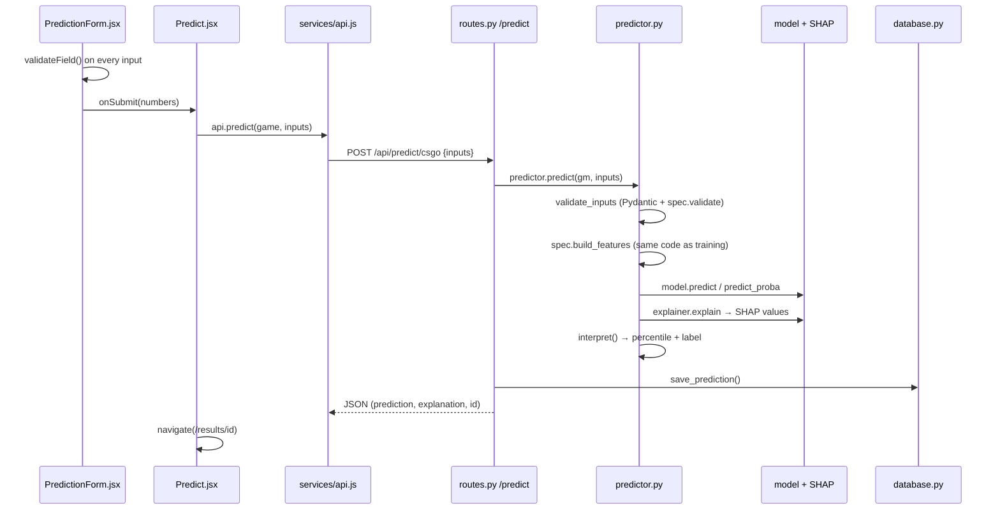

# Code Walkthrough & Mind Map

A guide to every part of the project: what each file does, how the parts connect, and where to look
when someone asks "show me where you did X".

**How to read it:** start with the mind map (§1) and the three flows (§2). Then read the file-by-file sections
(§3–§7) for the parts you need to explain. §8 is a quick lookup table for viva questions.

---

## 1. Mind map



The same structure as plain text, for anywhere Mermaid doesn't render:

```
Statline
├── DATA        data/raw/<game>/*.csv  (not in Git; downloaded from Kaggle)
├── ML          ml/  ── offline, run once:  CSV → clean → features → 5 models → best → SHAP → artifacts
│   ├── common/     shared code used by all 4 games
│   ├── <game>/     preprocessing.py, feature_engineering.py, train.py, evaluate.py
│   ├── experiments/  two "can we predict MMR?" tests (both: no)
│   └── artifacts/  trained output the backend reads
├── BACKEND     backend/app/  ── FastAPI server: validate → features → model → SHAP → SQLite
├── FRONTEND    frontend/src/  ── React website: forms, results, charts
└── RUN/SHIP    run.bat, scripts/, Dockerfile, render.yaml
```

---

## 2. The three flows

### 2.1 Training flow (offline; `python -m ml.train_all`)



1. `ml/train_all.py` calls `main()` in each `ml/<game>/train.py`.
2. `train.py` calls `preprocessing.load_and_clean()`. It reads the CSV files, removes bad rows and returns:
   the clean DataFrame, a list of cleaning steps, and the raw row count.
3. It then calls `ml/common/trainer.train_game(SPEC, df, log, raw_rows)`. `SPEC` comes from that game's
   `feature_engineering.py`.
4. `train_game` builds features, splits by player or match, trains 5 models, picks the best, cross-validates
   it, computes SHAP, and writes everything to `ml/artifacts/<game>/`.

### 2.2 Prediction flow (one click on "Submit prediction")



### 2.3 Start-up flow (`run.bat`)

1. Checks whether the app is already running (`/api/health`). If it is, it just opens the browser.
2. On the first run on a computer, it calls `scripts\setup.bat` to install everything.
3. It runs `npm run build`, which turns the React code into static files in `frontend/dist/`.
4. It starts `uvicorn` (the Python web server) with `backend/app/main.py`.
5. `main.py`'s `lifespan()` runs `init_db()` and `registry.load()`, so all four models are in memory.
6. A helper opens `http://localhost:8000` once the server answers. `main.py` serves both the website and the API.

---

## 3. Root folder files

| File | What it is |
|---|---|
| `run.bat` | One-click start (§2.3). Double-click it or the Desktop shortcut. |
| `requirements.txt` | Installs everything for development (it includes `backend/requirements.txt`, which includes `ml/requirements.txt`). |
| `requirements-deploy.txt` | Only what the live server needs, with **exact** versions matching the ones that trained the models. |
| `Dockerfile` | Recipe for the online deployment. Stage 1 builds the website with Node; stage 2 installs Python and copies `ml/`, `backend/app/` and the built site. |
| `.dockerignore` | Files Docker should skip (datasets, venv, docs). |
| `render.yaml` | Tells Render.com to build the Dockerfile as a free web service. |
| `pytest.ini` | Tells pytest where the tests are (`ml/tests`, `backend/tests`). |
| `.gitignore` | Keeps datasets, venv, node_modules and the database out of Git. |
| `.gitattributes` | Fixes line endings (`.bat` files need Windows CRLF). |
| `.env.example` | Optional settings (`DATABASE_URL`, `CORS_ORIGINS`, `ARTIFACTS_DIR`). |
| `README.md` | Project overview, setup, API list, troubleshooting. |

---

## 4. ML pipeline: `ml/`

### 4.1 `ml/common/`: shared by all four games

**`paths.py`**: one place for folder locations.
- `ROOT`: the project folder. `DATA_RAW`: `data/raw`. `ARTIFACTS`: `ml/artifacts`.
- `artifact_dir(game)` returns `ml/artifacts/<game>` and creates it if needed.

**`spec.py`**: describes a game's prediction task, so the trainer, the API and the website all follow the same definition.
- `InputField`: one form input, with name, label, tooltip text, type (`int`, `float` or `category`), hard
  min/max for validation, unit, options and group.
- `GameSpec`: everything about a game:
  - `key`, `name`, `task` (regression or classification);
  - `target_column` and the honest `target_name` plus `not_mmr_note`;
  - `group_column` for the split;
  - the list of `inputs`;
  - `build_features` (function), `validate` (cross-field rules), `target_range`;
  - row caps (`max_train_rows = 300,000`, `max_test_rows = 100,000`);
  - `extra` (feature display labels).

**`cleaning.py`**: `CleaningLog`.
- `apply(df, mask, step)` keeps the rows where `mask` is True and records how many were removed.
- `note(step, rows)` records a step without removing anything.
- The log ends up in `metrics.json` and appears on the Analytics page as the "Cleaning log".

**`trainer.py`**: the core of the ML work.
- `SEED = 42`, so results are reproducible.
- `candidate_models(task)` returns the 5 algorithms:
  - **Regression:** Linear Regression (with StandardScaler), Decision Tree (depth 12), Random Forest (100 trees),
    HistGradientBoosting (300 iterations), XGBoost (600 trees).
  - **Classification:** the same, with Logistic Regression instead of Linear Regression.
- `regression_metrics`: R², MAE, MSE, RMSE. `classification_metrics`: accuracy, precision, recall, F1, ROC-AUC.
- `train_game(spec, df, cleaning_log, raw_rows)` does, in order:
  1. `X = spec.build_features(...)`, `y = target`, `groups = player or match id`.
  2. **`GroupShuffleSplit(test_size=0.2)`**: rows from one player or match never land in both sets. The
     `assert` line checks this.
  3. Caps the training and test sizes, so training runs on a laptop.
  4. Trains every model, times it, and scores it on the test set (and on 50k training rows, to spot overfitting).
  5. Picks the best: lowest RMSE for regression, highest ROC-AUC for classification.
  6. **`GroupKFold(3)`** cross-validation of the winning algorithm.
  7. SHAP importance on 1,500 test rows (`global_importance`).
  8. `_analytics()` builds all the dashboard data: actual vs predicted, residual histogram, prediction
     distribution, error by decile, ROC curve, confusion matrix, calibration.
  9. Builds `schema.json`. For each input it stores the 1st–99th percentile range (the "typical range") and
     the median (the "Fill with medians" value). It also stores 101 quantiles of the target (used for
     percentiles) and the feature names and labels.
  10. Saves `model.joblib`, `schema.json`, `metrics.json`, `analytics.json`, `test_sample.parquet` and PNG
      plots (`_plots()`).

**`explain.py`**: SHAP explanations.
- `ModelExplainer(model)`:
  - **Tree models** use `shap.TreeExplainer`, which gives exact SHAP values.
  - **Linear models** (a Pipeline) compute contribution = coefficient × standardised value. That *is* the
    exact SHAP value for a linear model.
- `explain(X)` returns `(base_value, contributions)`. **base + sum of contributions = model output.** For
  Dota 2 the units are log-odds.
- `global_importance(model, X)`: mean |SHAP| per feature, sorted. This becomes the "Feature importance" chart.

**`evaluate.py`**: `evaluate_saved(game)` reloads `model.joblib` and `test_sample.parquet` and recomputes the
metrics. This proves the saved file is the same model that was evaluated.

### 4.2 One folder per game: `ml/csgo`, `ml/pubg`, `ml/valorant`, `ml/dota2`

Each has the same four files:

| File | Job |
|---|---|
| `preprocessing.py` | `load_raw()` reads only the needed columns. `load_and_clean()` reshapes, filters and logs, then returns `(df, log, raw_rows)`. |
| `feature_engineering.py` | `INPUTS` (the form fields), `build_features()` (raw inputs → model features), `validate()` (cross-field rules), `SPEC` (the `GameSpec`). **Used by both training and the API.** |
| `train.py` | `main()`: load_and_clean, then train_game. Run with `python -m ml.<game>.train`. |
| `evaluate.py` | Runs `evaluate_saved("<game>")`. |

What is different in each game:

| | CS:GO | PUBG | VALORANT | Dota 2 |
|---|---|---|---|---|
| Raw file | `players.csv` + `results.csv` | `train_V2.csv` | `data-since-april-2021.csv` | `players.csv` + `match.csv` |
| Special cleaning | `unpivot_maps()` turns the m1/m2/m3 columns into one row per map; rounds are joined from results.csv | keeps solo/duo/squad; samples 15,000 whole matches (`N_MATCHES`); removes kills-without-moving (cheaters) | reads with `encoding_errors="replace"`; drops shifted rows (agent not in `AGENT_ROLE`); range checks | Ranked All Pick only; drops matches with an abandon; win label from `player_slot` + `radiant_win` |
| Target | `rating` (HLTV) | `winPlacePerc` | `rating` (VLR) | `won` (0/1) |
| Engineered features | KPR, DPR, APR, K/D, HS %, opening duels/round | duo/squad flags, total distance, headshot rate | role one-hot, per-round K/D/A, K/D, FK/FD per round | KDA, kills/deaths/last hits/damage per minute |
| Excluded (leakage) | CT/T ratings | **killPlace**, maxPlace, numGroups, points | T/CT ratings | TrueSkill, total wins |
| Split by | player_id | matchId | player | match_id |
| `validate()` rules | headshots ≤ kills, deaths ≤ rounds | no revives in solo, headshots ≤ kills | FK ≤ kills, FK + FD ≤ rounds | K+D+A plausible for the duration |

### 4.3 `ml/experiments/`: the "why not MMR" proof

- `dota2_trueskill_feasibility.py`: averages each player's stats and tries to predict their TrueSkill μ with
  Linear Regression and XGBoost. Result: R² ≈ 0. Saved to `artifacts/experiments/dota2_trueskill.json`.
- `valorant_ranked_feasibility.py`: tries to predict rank tier (Immortal 1/2/3, Radiant) from ranked stats.
  Result: +0.7 percentage points over the majority-class baseline. `_conclusion()` writes the conclusion text
  *from the measured numbers*, so the text can't disagree with the results.

### 4.4 `ml/train_all.py`

`JOBS` maps names to functions. `python -m ml.train_all` runs everything; `python -m ml.train_all csgo` runs
just one game.

### 4.5 `ml/artifacts/<game>/`: what training produces

| File | Contents | Read by |
|---|---|---|
| `model.joblib` | the trained best model | backend (`registry.py`) |
| `schema.json` | inputs (labels, ranges, defaults), feature list, target names, target quantiles, model name | backend validation; the website builds the form from it |
| `metrics.json` | all 5 models' scores, CV result, dataset sizes, cleaning log | Analytics page, landing page |
| `analytics.json` | chart data (SHAP importance, scatter points, histograms, ROC, …) | Analytics page |
| `test_sample.parquet` | 20,000 test rows | `evaluate.py`, tests |
| `plots/*.png` | static charts | report and slides |

### 4.6 `ml/tests/test_ml.py` (27 tests)

- **Loading:** cleaning runs on the real files (`test_preprocessing_on_real_sample`).
- **Features:** formulas are correct, and there's no division by zero.
- **Validation:** the rules work (`test_cross_field_rules`).
- **Training:** the full trainer runs on fake data (`test_train_game_end_to_end`).
- **Saved models:** the reloaded model gives the same scores (`test_saved_model_reproduces_reported_metrics`).
- **SHAP:** base + contributions = output (`test_explainer_additivity`).

---

## 5. Backend: `backend/app/`

**`main.py`**: creates the FastAPI app.
- `lifespan()` runs at start-up: `init_db()` creates the SQLite table, and `registry.load()` loads the models
  **once**.
- CORS middleware lets the dev website on port 5173 call the API.
- `request_validation_handler` turns FastAPI's 422 errors into a `{status, detail, errors[]}` format.
- `unhandled` logs any crash and returns a plain "Internal server error". No stack traces reach the browser.
- `frontend(full_path)`: if `frontend/dist` exists, it serves the website files. Any unknown path returns
  `index.html`, so links like `/analytics` work. The check `DIST in candidate.parents` stops anyone reading
  files outside that folder.

**`core/config.py`**:
- `_load_dotenv()` reads the `.env` file.
- Adds the project root to `sys.path`, so the backend can `import ml...` and reuse the training code.
- `Settings` holds the artifacts folder, database URL, CORS origins, game list and website folder.

**`services/registry.py`**: loads the models.
- `GameModel`: everything about one loaded game (spec, schema, metrics, analytics, model, explainer, status,
  reason, and a lock).
- `ModelRegistry.load()`, for each game:
  1. imports `ml.<game>.feature_engineering.SPEC`;
  2. checks the 4 `REQUIRED` files exist;
  3. loads them and creates a `ModelExplainer`.

  If anything is missing, the game is marked `"unavailable"` with the reason, and the app keeps running.
  It also loads the experiment JSONs.

**`services/predictor.py`**: the prediction logic.
- `_input_model()` builds a Pydantic class from `schema.json`:
  - each number gets `Field(ge=min, le=max)`;
  - each category gets `Literal[options]`;
  - `extra="forbid"` rejects unknown fields;
  - `lru_cache` builds it only once.
- `validate_inputs()` runs Pydantic and then `spec.validate()`. Errors become `InputValidationError`, which
  becomes HTTP 422.
- `predict()`:
  1. validate;
  2. `build_features` (the same function as training);
  3. `predict` or `predict_proba`, inside `gm.lock`;
  4. `explain()`;
  5. clip to the valid range;
  6. add warnings for values outside the typical range;
  7. `interpret()`.
- `interpret()`:
  - **Regression:** the percentile comes from `bisect_left` on the 101 stored quantiles. `_band()` turns it
    into Weak, Below average, Average, Above average, Strong or Exceptional.
  - **Classification:** Likely win (≥ 65%), Toss-up, or Likely loss (≤ 35%).
- `explain()`: sorts contributions by size, adds readable labels, and writes the "Biggest boosts / drags" summary.

**`models/database.py`**: SQLite through SQLAlchemy.
- `Prediction` table: id, game, target_name, model_name, inputs (JSON), prediction, result (JSON), created_at.
- `init_db()`, `session()`, `save_prediction()`, `list_predictions()`, `get_prediction()`, `clear_predictions()`.
- To use MySQL instead, only `DATABASE_URL` changes.

**`schemas/api.py`**: the shapes of requests and responses: `PredictRequest {inputs}`, `GameSummary`,
`HealthResponse`, `HistoryItem`. They also generate the documentation at `/docs`.

**`api/routes.py`**: the endpoints.

| Endpoint | Function | Does |
|---|---|---|
| `GET /api/health` | `health()` | server up + status of each game |
| `GET /api/games` | `games()` | game list with target, model and headline score (`_summary`) |
| `GET /api/model-info` | `model_info_all()` | the same, plus full metrics |
| `GET /api/model-info/{game}` | `model_info()` | schema + metrics (the form is built from this) |
| `POST /api/predict/{game}` | `predict()` | predict + explain + **save to history** |
| `POST /api/explain/{game}` | `explain()` | the same, **without** saving |
| `GET /api/analytics/{game}` | `analytics()` | dashboard data |
| `GET /api/experiments` | `experiments()` | the two MMR experiments |
| `GET /api/predictions/history` | `history()` | saved predictions (filter by game) |
| `DELETE /api/predictions/history` | `clear_history()` | clears history |
| `GET /api/predictions/{id}` | `prediction_detail()` | one saved prediction (used by the Results page) |

Helpers: `_game_or_404` (unknown game → 404) and `_ready_or_503` (model missing → 503).

**`backend/tests/`**:
- `conftest.py` uses a temporary database and starts the app with `TestClient`.
- `test_api.py` (27 tests) covers every endpoint and every error type: 404, 422 (missing, wrong type, out of
  range, unknown field, rule broken) and 503.

---

## 6. Frontend: `frontend/`

**Config files**
- `package.json` lists the libraries (React, React Router, Recharts, Framer Motion, Axios, Tailwind, Vitest).
- `vite.config.js` holds the build settings and the test settings (jsdom).
- `index.html` is the single HTML page; React fills the `<div id="root">`.

**`src/main.jsx`**:
- Starts React inside `BrowserRouter` (for page URLs) and `MotionConfig` (respects "reduce motion").
- Loads the fonts and CSS.
- Has one mouse listener that sets `--mx`/`--my` for the spotlight hover glow.

**`src/App.jsx`**: the list of pages (routes). Results, Analytics, History and Methodology are `lazy()`-loaded,
so the first page loads faster.

| URL | Page |
|---|---|
| `/` | Landing |
| `/games` | Games |
| `/predict/:game` | Predict |
| `/results/:id` | Results |
| `/analytics?game=` | Analytics |
| `/history` | History |
| `/methodology` | Methodology |
| anything else | NotFound |

**`src/layouts/AppLayout.jsx`**: the frame around every page: the header with nav links (`NAV`), the mobile
menu, the API status dot, and the footer. `<Outlet />` is where the current page appears; `<Suspense>` shows a
loading skeleton while a lazy page loads.

**`src/services/api.js`**: every call to the backend.
- `API_BASE` is `http://localhost:8000/api` in development and `/api` when the API serves the site.
- `normalizeError()` turns any error into `{status, message, fieldErrors, generalErrors}`:
  - status 0: server not reachable;
  - 422: field errors, shown inside the form;
  - 503: model unavailable.
- The `api` object has `health()`, `games()`, `modelInfo()`, `predict()`, `analytics()`, `history()` and so on.

**`src/hooks/useApi.js`**: `useApi(fn, deps)` runs an API call and returns `{data, loading, error, reload}`.
- The `alive` flag avoids updating a page you've already left.
- `reload()` re-runs the call (used by the "Try again" buttons).

**`src/utils/`**
- `format.js`: number formatting (`fmt`, `fmtInt`, `fmtPct`, `fmtMetric`, `fmtPrediction`, `fmtDate`,
  `fmtInput`), plus metric names and help text (`METRIC_LABELS`, `METRIC_HELP`).
- `games.js`: `GAME_META` holds each game's icon, colour, title and blurb; `GAME_ORDER`; `metaFor(key)`.
  Only presentation lives here: model facts always come from the API.

**`src/components/`**
- `PredictionForm.jsx`: **the form is generated from `schema.inputs`**, so each game gets its own fields
  automatically.
  - `validateField()` checks required, number, whole number and min/max (the same rules as the server).
  - `Field()` draws one input with its label, tooltip, unit, typical range and error. Categories (PUBG mode,
    VALORANT role) appear as a radio group.
  - Buttons: "Fill with dataset medians" and "Clear". The submit sends real numbers to `onSubmit`.
- `GameMark.jsx` draws the coloured game icon tile. `Logo.jsx` is the logo. `ServerStatus.jsx` is the green or
  red dot that calls `/api/health`. `Reveal.jsx` is the fade-in on scroll.
- `ui/`: small reusable pieces:
  - `Button` (renders a link when given `to`);
  - `Card`, `CardHeader`, `CardBody`;
  - `Badge`;
  - `InfoTip` (tooltip that also opens with the keyboard);
  - `States`: `Skeleton`, `LoadingBlock`, `ErrorState`, `EmptyState`;
  - `StatTile` (label + big number);
  - `SectionHeading`.
- `charts/`: all charts use Recharts.
  - `theme.js` holds the chart colours (checked for colour-blind contrast).
  - `ChartCard.jsx` is the card around every chart, with a **Chart/Table toggle**. `DataTable` shows the exact
    numbers; `LegendDot` draws legend entries.
  - `ChartTooltip.jsx` is the hover box.
  - `ContributionChart.jsx` draws the SHAP bars for one prediction: cyan pushes the result up, red pushes it
    down, top 10 shown.
  - `AnalyticsCharts.jsx`:
    - `ImportanceChart` (SHAP importance);
    - `ModelComparisonChart` (bars, selected model highlighted);
    - `ActualVsPredictedChart` (scatter + diagonal line);
    - `HistogramChart` (residuals);
    - `DistributionCompareChart` (actual vs predicted, or wins vs losses);
    - `ErrorByDecileChart`;
    - `RocChart`;
    - `CalibrationChart`;
    - `ConfusionMatrix`.

**`src/pages/`**
- `Landing.jsx`: headline, `ModelBoard` (live list of models and scores), game cards, How it works
  (`STEPS`), model results table, Built with (`STACK`).
- `Games.jsx`: one card per game from `/api/games`. If a model is missing, the card says "Unavailable" with the
  reason, and its button is disabled.
- `Predict.jsx`: loads `/api/model-info/{game}` and shows `PredictionForm` plus `ModelPanel` (target, the
  not-MMR note, the model and its scores). `handleSubmit` calls `api.predict`, then navigates to
  `/results/{id}`. A 422 error is passed back into the form.
- `Results.jsx`:
  - Shows the prediction from the navigation state, or fetches it by id (so refreshing the page works).
  - Shows the big number, the band label and `PercentileScale` (or `ProbabilityScale` for Dota 2).
  - Then the not-MMR note, warnings, the `ContributionChart`, the explanation text and the input summary.
- `Analytics.jsx`:
  - `Overview` is the table across all games. Game tabs set `?game=`.
  - `GamePanel` loads `/api/analytics/{game}` and shows stat tiles, `ModelComparison` (chart + table with
    train vs test), SHAP importance, then the regression or classification charts, and the cleaning log.
- `History.jsx`: table from `/api/predictions/history`, game filter, click a row to reopen it, "Clear history".
- `Methodology.jsx`: the written explanation. The dataset cards, feature chips and the two experiment results
  (`TrueSkillExperiment`, `RankedExperiment`) are loaded live from the API.
- `NotFound.jsx`: the 404 page.

**`src/styles/index.css`**
- `@theme` holds the colour and font tokens (used as Tailwind classes such as `bg-card` and `text-muted`).
- `.num`: monospace digits. `.label-sm`: small labels.
- Hover effects:
  - `.hover-pop`: cards lift and glow;
  - `.hover-chip`: small options pop;
  - `.hover-row`: rows highlight;
  - `.field-glow`: inputs glow;
  - `.card-glow`: chart borders;
  - `.btn-pop`: buttons lift;
  - `.spotlight`: glow that follows the mouse.
- `--pop` sets the glow colour (the game's colour). Movement is turned off under `prefers-reduced-motion`.

**`src/test/`**:
- `setup.js` adds browser features jsdom lacks.
- `fixtures.js` holds sample API responses.
- `app.test.jsx` (19 tests) covers formatting, validation, the form, pages, navigation, the offline error and
  the 404 page.

---

## 7. Scripts, deployment and docs

| File | Does |
|---|---|
| `scripts/setup.bat` | creates `.venv`, installs Python packages and `npm install` |
| `scripts/train_all.bat` | retrains everything |
| `scripts/run_backend.bat` / `run_frontend.bat` | developer mode (two terminals, live reload on port 5173) |
| `scripts/run_tests.bat` | pytest + vitest |
| `scripts/create_shortcut.bat` + `statline.ico` | the Desktop shortcut |
| `scripts/e2e_check.py` | Playwright opens a real browser, uses every page, predicts for all 4 games, checks mobile layout, saves screenshots to `docs/screenshots/` |
| `Dockerfile`, `render.yaml` | online deployment (`docs/deployment.md`) |
| `docs/*` | report, methodology, dataset documentation, testing report, user guide, viva preparation, deployment, PPT corrections, this file |

---

## 8. "Where in the code is …?" (viva lookup)

| Question | Open | Point at |
|---|---|---|
| Where is the data cleaned? | `ml/<game>/preprocessing.py` | `load_and_clean()`, each `log.apply(...)` line |
| Where are the features made? | `ml/<game>/feature_engineering.py` | `build_features()` |
| How do you avoid data leakage? | `ml/<game>/feature_engineering.py` (PUBG, VALORANT and Dota 2 list the excluded columns in the top comment; CS:GO only loads the columns it uses) + `ml/common/trainer.py` | `GroupShuffleSplit` + the `assert` that no group is in both sets |
| Where are the 5 models? | `ml/common/trainer.py` | `candidate_models()` |
| How is the best model chosen? | `trainer.py` | `best = (min if regression else max)(results, key=...)` |
| Where is cross-validation? | `trainer.py` | `GroupKFold(n_splits=3)` |
| Where is SHAP? | `ml/common/explain.py` | `ModelExplainer.explain()` |
| How do you know the saved model is right? | `ml/common/evaluate.py` + `test_saved_model_reproduces_reported_metrics` | |
| Where are the models loaded? | `backend/app/services/registry.py` | `ModelRegistry.load()` (once, at start-up) |
| How is input validated? | browser: `PredictionForm.validateField()`; server: `predictor._input_model()` + `spec.validate()` | three layers |
| What if a model file is missing? | `registry.py` → status "unavailable"; `routes._ready_or_503()` → HTTP 503 | |
| How is the percentile computed? | `predictor.interpret()` | `bisect_left` on `target_quantiles` |
| Where is history stored? | `backend/app/models/database.py` | `Prediction` table, `save_prediction()` |
| How does the website get the form fields? | `Predict.jsx` → `api.modelInfo()` → `schema.inputs` → `PredictionForm` | |
| How does the website talk to the backend? | `frontend/src/services/api.js` | the `api` object (Axios, JSON) |
| Why did you not predict MMR? | `ml/experiments/*.py` → shown on the Methodology page | |
| How is everything tested? | `ml/tests`, `backend/tests`, `frontend/src/test`, `scripts/e2e_check.py` | `docs/testing_report.md` |

### Explaining the code in 2 minutes

> "The project has three layers. The **ML layer** in `ml/` runs offline. For each game, `preprocessing.py`
> cleans the raw Kaggle data and `feature_engineering.py` defines the inputs and turns them into features. The
> shared `trainer.py` splits by player or match, trains five algorithms, keeps the best, cross-validates it,
> computes SHAP values and saves the model plus JSON files.
>
> The **backend** in `backend/app` is FastAPI. At start-up `registry.py` loads the four models once. When a
> prediction comes in, `predictor.py` validates it against the saved schema, builds features with the *same*
> function used in training, predicts, explains with SHAP and stores the result in SQLite.
>
> The **frontend** in `frontend/src` is React. The prediction form is generated from each model's schema,
> `api.js` sends the numbers to the backend, and the results page draws the SHAP chart with Recharts. The
> analytics page shows the real training metrics. `run.bat` builds the site and starts everything with one
> click."
